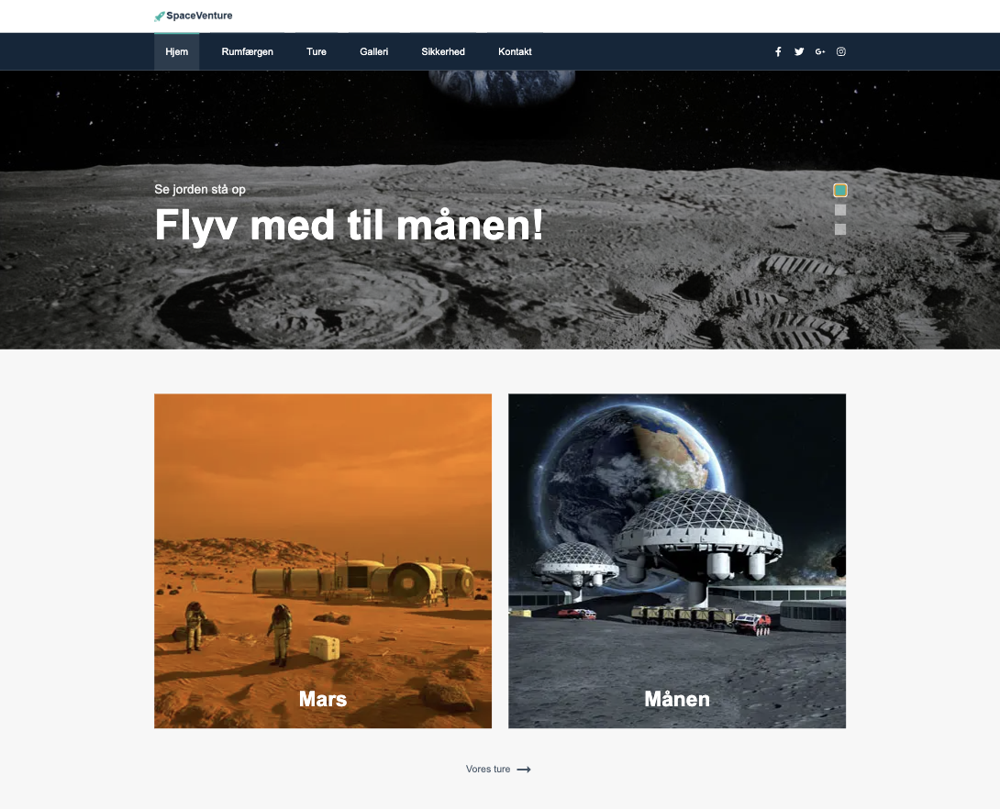
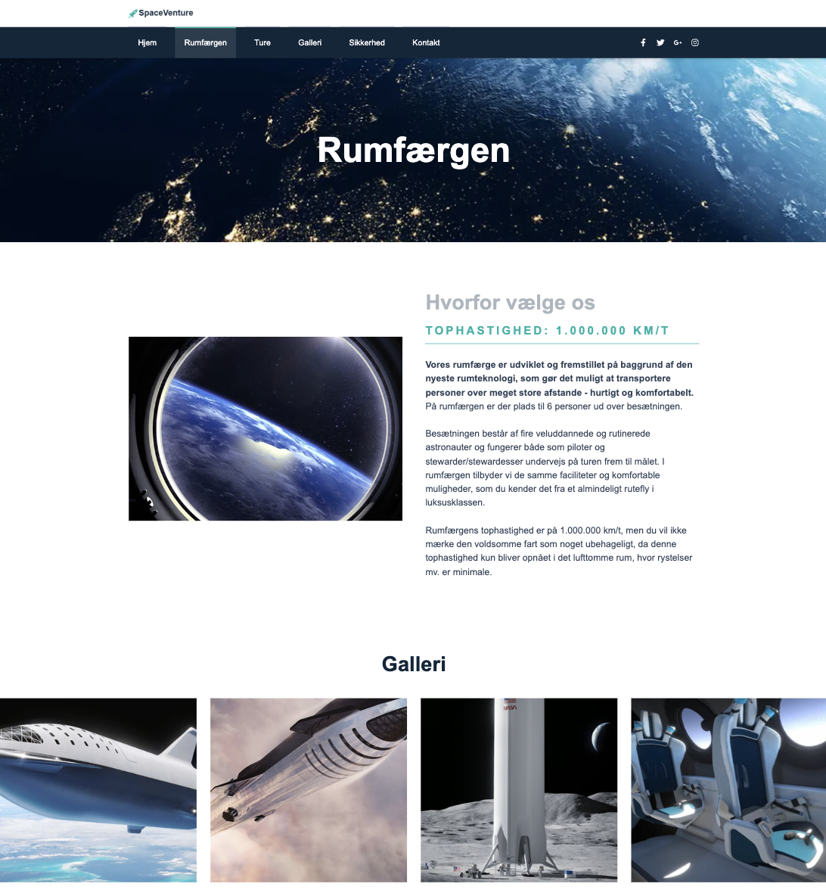
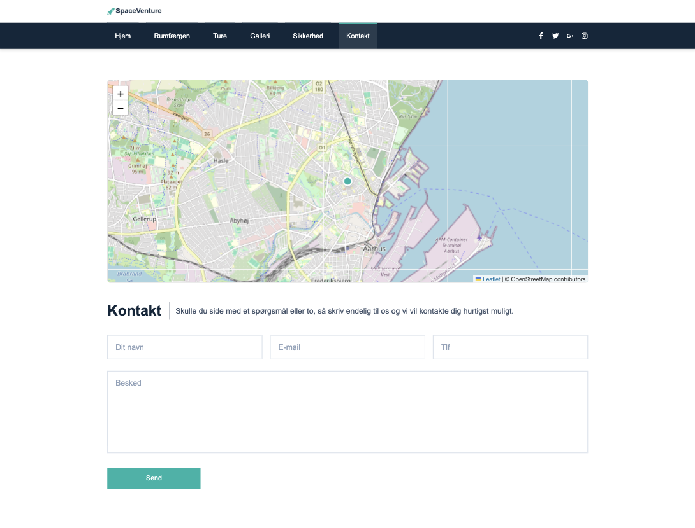

# 🚀 Spaceventure

My final exam project from the Web Developer education at Viden Djurs.

**Grade: 12**

For the exam, I was provided with a design and a backend API and tasked with turning them into a functional frontend application. 
I built the frontend using Next.js, React, TypeScript, and Tailwind CSS.

## 📸 Screenshots

### Homepage


### Spacecraft


### Contact & Interactive Map


## 🛠️ Tech Stack

- Next.js
- React
- TypeScript
- Tailwind CSS
- Leaflet / React Leaflet
- Zod

## ✨ Project Highlights

During the project I worked with:

- Building a responsive frontend from a provided design
- Integrating the frontend with an existing REST API
- Building reusable components with React and TypeScript
- Form and data validation with Zod
- Creating and managing tours through an admin interface
- Image uploads and previews
- Interactive map functionality with Leaflet and OpenStreetMap
- Contact form and management of submitted messages
- Gallery and lightbox functionality with keyboard navigation
- Routing and page structure with Next.js

## 🎓 About the Project

Spaceventure was developed as my final exam project during my
Web Developer education at Viden Djurs.

The project gave me the opportunity to bring together what I had learned throughout my education, including building a larger frontend, working with an existing API, structuring components, handling validation, and implementing a provided design.

I received the grade **12** for the final examination.

## 🚀 Running the Project Locally

Clone the repository and install the dependencies:

```bash
git clone https://github.com/Musho-hub/spaceventure-frontend.git

cd spaceventure-frontend

npm install

npm run dev
```

The frontend was developed against a backend API provided as part of the exam assignment. The provided backend is not included in this repository, so some functionality and data will not be available when running the frontend on its own.